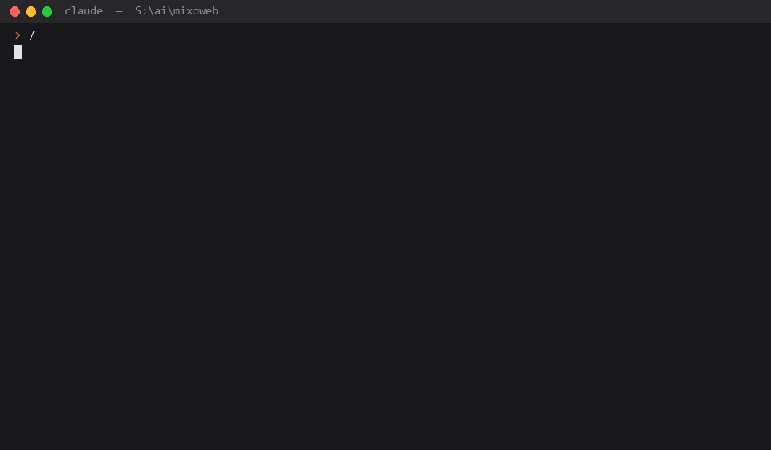

<div align="center">

# cia — Code Integrity Auditor

### 程式碼完整性稽核 · a skill for Claude Code and OpenAI Codex

**Your tests are green. Your system is still broken.**<br/>
**`cia` finds the bugs that live *between* two correct functions — and proves what it checked.**

**測試全綠，系統照壞。`cia` 專抓藏在「兩個各自正確的函式之間」的 bug，而且每一條結論都附證據。**

[](https://github.com/mixocreative/cia/actions/workflows/tests.yml) [](LICENSE) [](#install) [](#install) [](#how-it-is-measured) [](#how-it-is-measured) [](https://github.com/mixocreative/cia/stargazers)

[Quick start](#quick-start) · [Wiring audit](#wiring-walk) · [What it catches](#what-it-catches) · [Where it fits](#where-it-fits) · [How it is measured](#how-it-is-measured) · [FAQ](#faq) · [Install](#install)

```bash
claude plugin marketplace add mixocreative/cia && claude plugin install cia@mixocreative-cia
```



</div>

---

You shipped. Every test passed. Then a setting in the admin panel turned out to change nothing, a nightly job stopped three weeks ago without a word, and the "0 problems" health check had never looked at anything. Each function was correct on its own. The bug was in the wire between them.

Ask your agent to run `/cia`. It maps your codebase, follows every value from where it is written to every place it is read, follows every switch from the screen to the line that should obey it, runs your app for real, and hands back a report where **nothing counts as "passed" unless this run produced the evidence**.

> 程式上線了，測試也全過了。結果後台某個開關其實什麼都沒控制、某個排程三週前就默默停了、健康檢查回報「0 個問題」其實從來沒檢查過任何東西。每個函式單獨看都沒錯，錯的是它們之間的那條線。
>
> 對你的 AI Agent 輸入 `/cia`：它會先畫出整個系統的地圖，追蹤每個值從寫入到每一個讀取點、每個開關從畫面到真正該執行的那一行程式碼，實際把 App 跑起來走一遍，最後交出一份報告 —— **沒有這次執行產生的證據，就不算通過。**

<a id="quick-start"></a>

## Quick start｜快速開始

**1. Install｜安裝** — one command in Claude Code (other options under [Install](#install)):

```bash
claude plugin marketplace add mixocreative/cia && claude plugin install cia@mixocreative-cia
```

**2. Ask your agent｜直接對 Agent 下指令** — copy any of these:

```text
/cia pre-launch audit, Screen tier
```

```text
Before we ship: trace every admin setting to the line of code that obeys it,
and show me the ones nothing reads.
```

```text
Our tests say green. Prove they actually ran the database and browser tests,
and list everything that was NOT verified.
```

```text
上線前幫我用 /cia 稽核：哪些後台開關其實沒有程式在讀？哪些排程停了不會有人知道？
```

**3. What comes back｜你會拿到什麼** — a numbered report that opens with five plain-language lines for the owner (what is safe, what is not, what to do first), then one line per step, every sweep naming the files it read:

```text
Tier: Screen — elapsed 3h10m (budget 2–4 h)
1. Fast lint + scope tests ............ ✅ <N> tests green
2. Integrity sweeps S1–S24 ............ ❌ <N> findings, each with path:line + a quoted line
3. Full suite on HEAD <sha> ........... ✅ <N>/<N>   (or ⏭ with the one command you must run)
4. Runtime walk ....................... routes / assets / error-log delta / closed-loop clicks
5. Fixes applied (one commit + test each) | Escalated to you, with the patch attached
9. Evidence ledger .................... PASS / FAIL / UNVERIFIED / UNPROVEN — every PASS cites an artefact
```

<a id="wiring-walk"></a>

## Feature list vs wiring audit｜功能清單 vs 串接稽核

A feature comparison asks: *"Do we have retries?"* A wiring audit asks: ***"What happens if the job is accepted, the worker dies, the input changes underneath, the result write fails, and someone opens the dashboard on Monday?"*** That is where in-house systems break — and `cia` writes that question for *your* system first, then answers it with evidence.

> 功能比較問的是：「我們有重試機制嗎？」串接稽核問的是：**「如果工作被接受了、Worker 掛了、輸入資料被改了、結果寫入失敗，而有人星期一才打開儀表板，會發生什麼事？」** 自己寫的系統就是在這裡出事。`cia` 會先針對你的系統寫出這個問題，再用證據回答。

- **Three layers, every run｜每次檢查三層:** function logic · relationship wiring (called, persisted, retry-safe, partial failure handled) · lifecycle rules (late, twice, out of order). Findings are counted per layer.
- **A lifecycle state map｜流程對照圖:** for intake, processing, external calls, reversal, notifications and stored artefacts — expected path (from a mature reference or your spec, used as a **checklist, never the truth**) beside your real path, its failure/retry path, and what the operator actually sees.
- **Seven questions for every connection｜每條串接七問:** actually called? result saved? safe twice? one authority when systems disagree? can a job die unnoticed? does an unresolved case reach a screen? is there a test that breaks *this* connection?
- **Seven deliberate failures｜七種故障注入:** reject a downstream write · replay a message · event before its predecessor · two actors on the last unit · timeout while the far side succeeded · remove an artefact a record points to · stop a background job. Passing means **recovered, or visible to the operator** — nothing else.
- **The deliverable｜交付成果:** a rule traceability matrix (rule · code that enforces it · connected systems · proof · covered/gap) and a gap register with exact `file:line` and proof status. Ask *"what should we audit next?"* and a **reference-guided Walk** is what it recommends. Full method: `references/wiring-walk.md`.

<a id="what-it-catches"></a>

## What it catches｜它抓到過什麼

Real defects from real runs. Every one sat behind a green suite.

> 以下都是真實執行中抓到的缺陷，而且每一個發生時，測試都是全綠的。

| Case｜案例 | What everyone saw｜大家看到的 | What was actually true｜實際上 |
|---|---|---|
| **The button that lied**｜會說謊的按鈕 | Every install button showed a progress bar, then snapped back to "Download and install". | The download was still running. A 5-second `setInterval` redraw rebuilt the list from `installed: false`, and every test's fake download finished inside one cycle. Now sweep S22.10. |
| **Six days of 403s**｜六天的 403 | Every admin page answered 200. | Every stylesheet answered 403 — the install root had moved and every derived asset URL landed in a denied directory. Now walk step (a). |
| **Eleven days pinned left**｜被釘在左邊十一天 | Every route 200, every asset 200, error log silent. | Every shop page sat in a fixed-width box against the left edge: a shared wrapper changed, and the commit was probed on the two pages that didn't use it. Now walk step (f): measure, don't screenshot. |
| **The password that never was**｜從沒存進去的密碼 | A dev seeder printed the admin password. | The framework silently dropped that field on that save path; the seeder printed its intent, not the stored value. Now §0.12: a tool that reports success must prove it. |
| **The hidden cron**｜繞過控制面的排程 | The app has a cron control plane. | One job ran outside it (the demo GIF above, on a production PHP/ProcessWire shop), with `file:line` evidence and the fix. |

Used `cia` on something interesting? [Share the lesson](https://github.com/mixocreative/cia/issues/new?template=lesson.md) — the best ones become sweeps.

> 用 `cia` 抓到有趣的 bug 嗎？歡迎[分享你的案例](https://github.com/mixocreative/cia/issues/new?template=lesson.md)，好案例會變成新的掃描項目。

<a id="where-it-fits"></a>

## Where it fits｜適用的專案

| Project｜專案類型 | What `cia` checks｜檢查重點 | Needs｜需要 |
|---|---|---|
| Web app / admin panel｜網站、後台 | settings → consumer, closed-loop buttons, redraws that wipe progress, layout geometry, every route and asset | a browser automation tool your agent can drive (Playwright, Claude in Chrome) |
| Service, worker, job runner｜服務、排程、背景工作 | work that stops in a non-terminal state, dead watchdogs, retry storms, races fired twice for real | the project's own run / test commands |
| CLI or library｜命令列工具、函式庫 | smoke commands, exit codes that lie, codecs proven only against themselves | the documented smoke commands |
| AI / LLM app, n8n workflow｜AI 應用、n8n | model output as untrusted input, agent loops with no cap, side effects without idempotency | nothing extra — §0.10 turns on automatically |
| Blender add-on｜Blender 外掛 | undo atomicity, modal state, property write conflicts | Blender for the runtime walk |
| Online shop｜電商 | all of the above, then tells you to run the sibling [ecommerce-cia](https://github.com/mixocreative/ecommerce-cia) for payment, stock and refund doctrine | — |

<a id="faq"></a>

## FAQ｜常見問題

<details>
<summary><strong>Isn't this just a code review with extra steps?｜這不就是 Code Review 嗎？</strong></summary>

No. Review asks *is this line right?* Tests ask *does this unit behave?* `cia` asks *who reads this value, and who finds out when it goes wrong?* — the question neither asks. It does not replace review or tests; it runs your tests (Steps 1 and 3) and then audits them too (S21). See [How this is different](#how-this-is-different).

> 不是。Review 問「這行寫對了嗎」，測試問「這個單元動作對嗎」，`cia` 問的是「這個值誰在讀？出錯時誰會知道？」它不取代 Review 或測試，而是把測試跑完之後，再檢查測試本身有沒有真的在驗證東西。
</details>

<details>
<summary><strong>How long does it take, and what does it cost?｜要多久？花多少？</strong></summary>

Three depth tiers, and the report's first line says which one ran: **Screen** 2–4 h, **Walk** 1–2 days, **Full** open-ended. Measured runs used 121k–259k tokens, about 10k–29k per finding. A bare "run the tests" only runs your tests and *offers* the audit.

> 三種深度：**Screen** 2–4 小時、**Walk** 1–2 天、**Full** 不設限，報告第一行會寫明跑的是哪一種。實測每次約 121k–259k tokens。只說「跑測試」時，它只會跑測試，然後詢問你要不要做完整稽核。
</details>

<details>
<summary><strong>Will it change my code?｜它會改我的程式嗎？</strong></summary>

Only when a fix is local, reversible, carries a new test that proves it, and touches no shared state or secret — one commit per finding, on a working branch unless your `CLAUDE.md` / `AGENTS.md` says otherwise. Never pushes. Anything irreversible, shared, or a decision is escalated to you with the patch attached, unapplied.

> 只有在「改動在本地、可還原、附上證明它的測試、不碰共用資料與金鑰」時才會自動修，一個發現一個 commit，且不會 push。其他一律附上修正 patch 交給你決定。
</details>

<details>
<summary><strong>Does my code leave my machine?｜程式碼會被上傳嗎？</strong></summary>

`cia` is a set of instructions your agent follows locally; it adds no service of its own. What your agent sends to its model provider is governed by that provider's policy. It never calls live third-party endpoints with side effects — sandbox or mock only.

> `cia` 只是一套讓 Agent 在本機遵循的指令，本身不連任何服務。Agent 傳給模型供應商的內容依該供應商的政策處理。它絕不呼叫有副作用的正式第三方 API。
</details>

<details>
<summary><strong>I'm not an engineer. Can I use it?｜我不是工程師，能用嗎？</strong></summary>

Yes. Say so, and the plain-language contract (§0.15) binds every message to plain words: what is safe, what is not, what to do first. Prompts in 繁體中文 work too.

> 可以。告訴它你不是工程師，它就會全程用白話說明：哪裡安全、哪裡不安全、先做什麼。也支援繁體中文指令。
</details>

<details>
<summary><strong>Why should I trust an AI auditor?｜為什麼要相信 AI 稽核？</strong></summary>

Don't — trust the evidence. Reading code never produces PASS in this skill; only an artefact from this run does. And the skill is scored the same way: a planted-defect fixture, a corpus of real bugs audited at the commit *before* the fix, and twelve look-alike-but-correct controls. Numbers are in [How it is measured](#how-it-is-measured), including the miss.

> 不用相信 AI，相信證據就好。在這個 Skill 裡，「讀過程式碼」永遠不算通過，只有這次執行產生的證據才算。Skill 本身也用同樣的標準被評分，包含它漏掉的案例。
</details>

<details>
<summary><strong>Which agents does it run on?｜支援哪些 Agent？</strong></summary>

Tested on Claude Code (plugin or skill directory) and OpenAI Codex. The skill is plain Markdown plus small Python tools, so other agents that load `SKILL.md` folders may work; reports welcome.
</details>

---

<a id="about"></a>

## About｜關於

**New in this release — evidence discipline borrowed from reverse engineering.** Every claim is tagged OBSERVED / INFERRED / UNKNOWN; every promise the owner made becomes an **obligation** with exactly one owner in the code and a verifier that names it; a test can only close a claim at its own strength (a mocked gateway never proves a real callback); "nothing reads it" must state where it looked; cut-off output is never counted; contradictions between manual, sandbox and code are recorded instead of resolved by preference; and a new **reverse-trace mode** starts from what the system visibly does and traces inward. See `references/evidence.md`. Ideas adapted from [REA](https://github.com/morluto/rea).

> **本版新增：從逆向工程借來的證據紀律。** 每一條結論都標記「實測 / 推論 / 未知」；老闆說過的每一個承諾都變成一條**義務（Obligation）**，在程式裡必須剛好有一個負責者、一個點名它的驗證；測試只能證明與自己同等強度的事（用假金流的測試，永遠證明不了真的 Callback）；「沒有程式在讀」必須說清楚找過哪裡；被截斷的輸出不算數；手冊、測試環境與程式碼互相矛盾時，記錄下來而不是挑方便的那邊相信；新增**反向追蹤模式**：從系統看得見的行為出發，一路追到程式碼裡。詳見 `references/evidence.md`。概念改編自 [REA](https://github.com/morluto/rea)。

**Last scored fixture run:** see `tests/RUNS.md` — `python tools/score.py` prints it, `--gate` refuses a push that scores below the run before (RUNBOOK step 6).

A skill for Claude Code and OpenAI Codex that audits a codebase as a **viable system** in Stafford Beer's sense, and hunts the defect class that only such a view can see: **cross-boundary invariant violations**, also called **integration-level** or **emergent defects**.

> 這是給 Claude Code 與 OpenAI Codex 使用的 Skill。它將整套程式碼視為 Stafford Beer 所定義的「可存活系統」（Viable System）來進行稽核，專門抓出只有從這個視野才能發現的 bug：**跨邊界不變量違反**（cross-boundary invariant violations），亦即**整合層級缺陷**或**湧現缺陷**。這類 bug 不會單獨存在於任何一個函式中，而是藏在兩個「各自運作正常」的函式交界處。

Since v2.0 the skill is a runbook plus reference files: twenty-two sweeps instead of fourteen, depth tiers so a run says what it did and did not walk, sweep lines that name their sites and quote a line from one of them, a plain-language contract for owners who are not engineers, a paired run with `ecommerce-cia`, and a fixture project with an answer key that fresh agents are cold-tested against.

> 自 v2.0 起，本 Skill 已演進為一套 Runbook 搭配參考文件：掃描項目（Sweeps）從原本的 14 項擴增至 22 項；導入深度分級機制（Depth Tiers），讓每次執行都能清楚交代檢視與未檢視的範圍；掃描結果行會直接標示檔案位置並引用相關程式碼；針對非工程背景的 Owner 提供白話文合約機制；支援與 `ecommerce-cia` 協同執行；並附帶包含標準答案的測試專案（Fixture），用於對全新的 Agent 進行冷測試（Cold test）。

<a id="how-this-is-different"></a>

## How this is different from a code review｜與一般 Code Review 的差異

**Ordinary code review, linters and AI "review my code" tools find coding errors**: a typo, a null that was not checked, a function that returns the wrong type, a style violation, a bug inside one function. They read the code and ask *is this line written correctly?*

**This skill checks whether the logic actually works as a whole.** It asks *when this runs, does the system do what you think it does?* It follows one value from where it is written to every place it is later read. It follows one switch from the admin screen to the line of code that is supposed to obey it. It checks whether "tests passed" means the tests actually ran.

| | Ordinary code review / linter｜一般 Review / Linter | This skill｜本 Skill |
|---|---|---|
| Question asked｜核心提問 | Is each line written correctly?｜每一行程式碼寫得對不對？ | Does the whole thing behave the way you think?｜整體實際運作是否符合預期？ |
| Unit of inspection｜檢查範圍 | one file, one function｜單一檔案、單一函式 | one value across time, one switch across layers｜跨時間的值演變、跨架構層級的開關 |
| Finds｜能抓出的問題 | syntax, types, null checks, style, a bug inside a function｜語法、型別、Null 值、Style 規範、函式內部的 bug | a switch nobody reads, a check forgotten before the action, a green report that skipped the real tests, a vendor field read wrong｜沒任何程式讀取的無用開關、檢查完卻沒再確認就動作、並未真正執行測試卻回報通過的綠燈、對第三方廠商欄位解析錯誤 |
| Cannot find｜無法抓出的問題 | anything that lives *between* two correct functions｜任何夾在兩個正確函式*之間*的邏輯漏洞 | (it starts there)｜（這正是本 Skill 發揮作用之處） |
| Proof it accepts｜採認的驗證標準 | "tests pass"｜「測試通過」即可 | the exact run line with counts, or "not verified"｜必須有實際跑過的行數數據，否則一律標示為「未驗證」 |

Both are needed. Run the linter for the lines. Run this for the logic.

> **一般的 Code Review、Linter 以及各類「幫你看程式碼」的 AI 工具，重點都在找寫錯的地方**：例如打錯字、漏掉 Null 檢查、回傳型別錯誤、格式不合規範，或是單一函式內部的 bug。它們閱讀程式碼時，問的問題是：「這行程式碼有沒有寫對？」
>
> **而本 Skill 則是直接稽核整套邏輯是否真能正常連動。** 它問的是：「系統實際執行時，運作方式真的跟你想的一樣嗎？」它會追蹤變數：從寫入點一路追到後續每一個讀取點；它會追蹤開關：從後台設定畫面一路追到理論上該受控的那一行程式碼；它也會嚴格審查「測試通過」到底是不是真的有落實執行。
>
> 兩者相輔相成。Linter 負責顧好每一行程式碼，這個 Skill 則負責掌控整體邏輯。

## In plain words｜白話文解釋（非技術人員版）

Think of any piece of software as a small company. Some staff **do the work** (handle a request, save a record, send an email). Some **keep the workers from tripping over each other** (queues, locks, "one at a time" rules). A **manager's settings panel** tells the workers what is switched on. An **auditor** checks the books. Someone **reads the outside world's rulebooks** (a bank's API spec, a vendor's file format). And an **owner** decides what happens when something goes wrong.

Most code-checking tools ask: *does each employee do their own job correctly?* This skill asks: *do they actually talk to each other, and at the right time?* Three real-shaped examples:

1. **The manager flips a switch in the settings panel. Nobody on the floor is listening.** The switch exists, the code behind it is fine, and no running code ever reads it. Every piece is "correct". The feature the manager thinks is off is still on. This skill calls it a *dead control* and checks every setting against the code that is supposed to obey it.
2. **A clerk checks that a seat is free, walks to the desk, then books it without looking again.** Two clerks do this at once; two people get the same seat. Each clerk followed procedure. The gap between "check" and "act" is where the bug lives. *Time-of-check to time-of-use race.*
3. **The auditor says "all good!" but only opened the pages that were on the desk.** The pages in the locked cabinet were skipped because the key was missing that day. The report is green and means nothing. *Vacuous pass.* This skill treats every skipped test as "not verified", never as "passed".

What it does, in order: draws the org chart of your code first (who does the work, who coordinates, who sets policy, who audits, who faces the outside), then checks every conversation between them, then tells you exactly which conversation is broken, in which file, on which line, and how to fix it.

> 請將一套軟體想像成一家小公司。裡面有**第一線員工**負責執行實務（處理 Request、存取資料、寄發 Email）；有**主管**負責協調，不讓大家撞在一起（包含排隊機制、加鎖鎖定、「一次一人」的規則）；有**店長的控制面板**用來開關各種功能；有**稽核會計**負責定期查帳；有**專人負責研究外部規則**（例如銀行的 API 規格書、物流廠商的檔案格式）；最後還有**老闆**負責決定系統出事時的應變政策。
>
> 多數檢查程式碼的工具問的是：*每個員工有沒有把自己的工作做對？* 這個 Skill 問的則是：*員工之間到底有沒有正確溝通？而且時間點對不對？* 以下是三個實際發生的情境：
>
> 1. **店長在控制面板關掉了一個開關，但樓下員工完全沒收到通知。** 設定開關確實存在，後端程式碼也寫得沒錯，卻沒有任何執行中的程式去讀取這個設定。每個部分單獨看都「正確」，店長以為已停用的功能其實仍在背景運作。本 Skill 將這種狀況稱為**死開關**，會主動拿每一項設定去比對「到底有沒有程式碼在聽它命令」。
> 2. **櫃台先確認座位有空，接著走到座位區準備劃位，期間卻沒再確認一次就直接訂下去。** 若兩個櫃台同時這樣操作，就會導致兩人訂到同一個座位。每個櫃台各自都按流程走，bug 卻出在「檢查」與「執行」之間的空隙。這就是**檢查與使用之間的競態條件（Race Condition）**。
> 3. **會計回報「帳目完全沒問題！」，但實際上只翻了桌上隨手可拿的幾頁。** 鎖在櫃子裡的重點帳冊只因當天找不到鑰匙就被直接跳過。查帳報告顯示一片綠燈，卻毫無參考價值。這就是**空洞的測試通過**。本 Skill 會將所有被跳過的測試直接判定為「未驗證」，絕不盲目給予通過標籤。
>
> 本 Skill 的執行順序為：先繪製出整套程式碼的組織架構圖（區分執行層、協調層、政策層、稽核層以及對外介面），接著逐一檢查各層級之間的每一條溝通管道，最後精準回報哪條管道斷線、位於哪個檔案的第幾行，並提供修復建議。

## Objections, answered｜三個常見質疑

Three objections engineers raise when they first meet this skill, and the honest answer to each.

**1. "You are mixing code review with testing. They are separate stages for a reason."**
They stay separate here too: tests run in Step 1 and again in full in Step 3; review is a person or
a review tool. This skill is a *third* thing — a **cross-boundary invariant audit** — for the defect
that neither stage asks about: every function correct on its own, the failure in the channel
between two of them. A setting nothing reads, a watchdog that reports "0 problems" whether or not
it looked, a page that throws on every request while its guard test sits 4,500 tests deep in a
seven-hour suite. Review checks style and logic; tests check behaviour; neither asks *"who reads
this value?"* S21 ("the suite is an instrument too") is not a merge of the two — it audits the
tests for passes that prove nothing. **This skill does not replace review or tests, and says so.**

**2. "This is prompting dressed up in academic words."**
Prompting does not produce a numbered sweep list with an answer key. The fixture harness
(`tests/`) plants ten defects under a green suite and scores each cold run: hits, near-misses,
misses, false positives. That number moves when the doctrine moves; a prompting habit cannot be
scored. Where the objection is right is the vocabulary: `S5`, `System 3*`, `S22.8` are noise to a
reader who has not seen the map, which is why §0.15 / §0.16 bind every user-facing message to plain
words, and why this README says it in plain engineering terms first:
*this is a checklist of ways a system fails between its parts, walked along a map of who
controls what, with a test that proves the checklist still finds what it was written to find.*

**3. "Day-to-day coding does not need a systems model. CI/CD and discipline are enough."**
For a script, yes — which is why the audit has tiers, and Screen is two to four hours, not a
week. The case for it is code written *with* an AI: a day of agentic development creates ten
times the boundaries a person would, and "write a bit, test a bit" fails exactly at the
boundaries. CI catches regressions; it does not catch a feature that was designed and never
wired (S13), a control that reaches no decision (S5), or a detector that went blind (S20).
Invariants written at the source are what make AI-generated code *checkable* — the auditor has
something to hold the output to, instead of reading it and hoping.

## Watch it run｜實際執行示範


Real, unedited output of `/cia` in demo mode on a production PHP/ProcessWire shop: runtime discovery, the codebase mapped onto VSM Systems 1–5 with its channels, then two sweeps. It found a System 3 → System 1 channel that bypasses the app's own cron control plane, with file:line evidence and the fix. Replayed as a typed terminal for the recording; the text is the model's.

> 上圖為 `/cia` 在某個正式營運中的 PHP/ProcessWire 電商專案執行 Demo 模式的真實輸出內容，完全未經修改：系統先自動探索專案的運作機制，將程式碼對應至 VSM 的 System 1–5 架構並列出所有傳輸通道，隨後執行兩次完整掃描。它成功抓出一條繞過應用程式本身排程控制面的 System 3 → System 1 隱藏通道，並附上 `file:line` 的佐證程式碼與修復方案。示範影片採用打字終端機重播，所有文字皆由模型即時生成。

## The theory｜架構理論

Beer's Viable System Model (*Brain of the Firm*, 1972; *The Heart of Enterprise*, 1979) states that anything which stays alive in a changing environment has the same five-part structure, repeated at every level of recursion:

> Stafford Beer 所提出的可存活系統模型（Viable System Model, VSM；參見《Brain of the Firm》1972、《The Heart of Enterprise》1979）主張：任何能夠在動態環境中持續生存的系統，都具備一套相同的五層結構，且每個遞迴層級的結構完全一致：

| System｜系統層級 | Role｜架構角色 | In a codebase｜對應至程式碼中的元件 |
|---|---|---|
| **1** | does the work｜實際執行層 | request handlers, domain services, workers｜Request 處理器、Domain Services、背景運算 Task |
| **2** | damps oscillation between the parts of System 1｜協調層（防止 System 1 各元件互相衝突） | locks, queues, deadlines, idempotency keys, ordering｜Lock 機制、Queue 佇列、Timeout 期限、冪等鍵（Idempotency Keys）、執行順序控制 |
| **3** | commands and allocates resources to System 1｜管制與資源分配層（向 System 1 下達指令） | settings, feature flags, admin pages, config files｜控制台設定、Feature Flags、後台管理頁面、Config 檔 |
| **3\*** | audits System 1 directly, bypassing its own reports｜獨立稽核層（不採信 System 1 的自我回報，直接進行查帳） | test suites, probes, reconciliation scripts｜測試套件、Health Check 探測腳本、資料對帳腳本 |
| **4** | faces the environment and the future｜外部環境與未來規劃層 | vendor specs, external APIs, webhooks, callbacks｜第三方廠商 API 規格書、外部 API 串接、Webhook、Callback |
| **5** | identity and policy; receives the algedonic (pain) signal｜身份識別與政策層（負責接收「痛覺」警訊並決策） | defaults, catch-block posture, kill switches, fail-closed rules｜預設配置、Catch 區塊的處置邏輯、熔斷機制（Circuit Breaker）、Fail-closed 降級規則 |

The systems are joined by **channels**. Ashby's Law of Requisite Variety says a channel must carry as much variety as the thing it regulates, otherwise the control it claims to exercise is fictional. Beer's diagnosis of a failing organisation is almost never "a department is incompetent"; it is "a channel is missing, saturated, or bypassed".

> 系統與系統之間依靠**通道（Channel）**相連。根據 Ashby 的必要多樣性定律（Law of Requisite Variety）：控制通道所能承載的變化量，必須大於或等於受控對象產生的變化量，否則該「控制」便流於形式。Beer 在診斷出問題的組織時，結論幾乎從不是「某個部門能力不足」，而是「某條溝通通道遺失、阻塞，或是被直接繞過了」。

Software fails the same way. Every function can be correct and the system still not viable, because a channel between two correct pieces is broken: a System 3 setting no System 1 code reads, a System 3\* suite that reports green because the tests touching the store never ran, a System 4 field interpreted against the code's belief rather than the vendor's definition, a System 1 step that re-reads System 3 live after an earlier step froze a snapshot. Static analysis, linters and unit suites inspect one piece at a time and therefore cannot see a channel by construction.

> 軟體系統崩潰的方式完全相同。即使每個函式寫得完全正確，系統依然可能無法運作，原因往往出在兩個正常元件之間的通道中斷了：例如寫了 System 3 設定卻完全沒有任何 System 1 的程式碼去讀取；或是 System 3\* 的測試套件因為碰不到資料庫而跳過測試，卻回報全綠通過；或是 System 4 欄位未按廠商規範，而是依憑工程師主觀想像去解析；又或是 System 1 在前置步驟已凍結了快照，後續步驟卻又跑去讀取即時的 System 3 資料。靜態分析工具、Linter 和單元測試一次都只觀察單點，因此從架構視野上天生就無法察覺通道中斷的問題。

This skill was built after exactly that happened on a production shop: four money-path defects, all between correctly written functions, all invisible to a green suite, all found by a second auditor who traced channels instead of reading functions.

> 這個 Skill 的開發初衷，正是源於一次真實發生的線上慘劇：某個正式營運的電商網站，其付款流程中隱藏了四個致命缺陷。這四個問題全部夾在寫得毫無瑕疵的函式之間，自動化測試顯示全綠通過卻完全沒抓到，最後是第二位稽核人員透過「追蹤通道」而非「閱讀函式」才成功找出問題。

## The stance this skill takes from Beer｜繼承自 Beer 的核心立場

- **The purpose of a system is what it does** (POSIWID). Not what the docs, the comments or the admin screen say it does. An audit reads behaviour, and treats the written intent as a hypothesis to test against the running system.
  > **系統的真實目的，就是它實際呈現出來的行為**（POSIWID）。既非文件記載、註解說明，也不是後台畫面所宣稱的功能。稽核時只看實際行為，寫下來的設計意圖一律視為待驗證的假說。
- **Recursion.** Every System 1 unit is itself a viable system with its own 1–5. A payment module has its own control, its own audit, its own policy; the audit descends one level and asks the same five questions again.
  > **遞迴結構（Recursion）。** 每個 System 1 單元本身就是一個獨立的可存活系統，具備專屬的 1–5 結構。例如一個金流模組擁有自己的控制、稽核與政策機制；稽核下鑽至下一層時，同樣重複詢問這五個核心問題。
- **Variety engineering.** Complexity is not removed, it is absorbed or amplified. Every guard, validator, idempotency key and state machine is a variety attenuator; every default and fallback is an amplifier of whatever the environment throws in. Ask of each: does it match the variety of what it faces?
  > **多樣性工程（Variety Engineering）。** 複雜度不會憑空消失，只會被吸收或放大。每一個 Guard 條件、驗證器、冪等鍵、狀態機都在削減系統的變化量；而每一個預設值與 Fallback 降級機制，則是在放大外界傳入的未知變數。針對每個機制都必須審查：它是否有能力承受所面臨的變化量？
- **Autonomy with cohesion.** System 1 must be free to act without asking System 3 on every step (a checkout that blocks on live config on every request is not autonomous), yet System 3 must still be able to command it (a toggle nothing reads is not cohesion). Both failures are channel failures.
  > **自主性與一致性的平衡。** System 1 必須具備不需每步請示 System 3 就能直接執行的能力（若每次結帳 Request 都被即時讀取的 Config 檔卡住，就不算具備自主性），但 System 3 依然要能有效控制它（從不讀取的開關就不具備一致性）。這兩種失敗本質上都是通道失效。
- **The auditor is System 3\*.** This skill is the channel that bypasses the system's own reports. A green suite is System 3's report about itself; the audit exists precisely because that report can be vacuous.
  > **稽核者的定位即為 System 3\*。** 本 Skill 扮演的就是那條繞過系統自我診斷、直接深入查核的通道。全綠通過的測試只是 System 3 的自我診斷報告；而稽核機制之所以必要，正是因為這份報告可能存在虛報或漏測。
- **Algedonic signals must reach System 5.** A pain signal that stops in a log file has not reached policy. Every alert, every catch block, every refund path is traced to the point where identity decides.
  > **痛覺訊號必須成功傳遞至 System 5。** 若痛覺訊號僅停留在 Log 檔案中，就代表它從未抵達政策決策層。每一個 Alarm 警報、每一個 Catch 處理區塊、每一條退款流程，都必須一路追蹤到「最終由誰進行決策」的關鍵節點。

## How the theory becomes procedure｜從理論轉化為實際稽核流程

1. **Map the codebase onto Systems 1–5 first** (§0.9 step 0) and report the table: every component, its primary system, its channels as `producer → consumer`.
2. **Walk the channels** with twenty-two mandatory sweeps (§0.9); each defect class below is a named kind of broken channel, and each sweep enumerates its sites from the map rather than from grep.
3. **Grade viability, not just correctness**: §2 asks whether each of the five systems exists, whether System 3\* is independent of System 3, whether an algedonic path reaches System 5, whether variety is matched.
4. **Report structurally**: every finding names its defect class and the VSM channel it sits on.

> 1. **將程式碼對應至 System 1–5 架構**（§0.9 第 0 步），輸出結構化地圖：標示每個元件、其所屬的主要系統，以及對應的傳輸通道（`producer → consumer`）。
> 2. **沿著通道進行深度排查**：執行二十二項強制掃描（§0.9）。後續列出的每種缺陷類型，本質上都是某種具名的通道中斷狀況；每個掃描檢查點皆建構自架構地圖，而非盲目使用 Grep 搜尋。
> 3. **評估標準為「系統能否持續存活」，而非僅看「語法是否正確」**：§2 負責確認五個系統層級是否完備、System 3\* 是否獨立於 System 3 運作、痛覺傳導路徑是否能抵達 System 5，以及系統承載的多樣性變化量是否匹配。
> 4. **產出結構化稽核報告**：每個發現的漏洞皆須明確標註其缺陷類型以及對應的 VSM 通道位置。

## The defect classes it hunts｜專門獵捕的缺陷類型：跨邊界不變量違反

These are **cross-boundary invariant violations**: integration-level, emergent defects where every function is correct and the bug lives between them. Each sweep in section 0.9 names one; every finding states its defect class and its boundary location as `producer → consumer`:

> 以下皆屬於**跨邊界不變量違反**：各個函式單獨看都正確，bug 卻藏在函式之間的接縫處。§0.9 的每個掃描項目皆對應一種類型；每一筆發現項目都會詳細列出缺陷分類與邊界位置（`producer → consumer`）：

| Term｜專業術語 | Meaning｜詳細定義 |
|---|---|---|
| **TOCTOU race**｜檢查與使用之間的競態條件（TOCTOU） | a predicate checked at one step, dropped at the step that acts｜某個條件在檢查當下成立，但在實際執行動作時該條件已失效 |
| **Temporal coupling / stale snapshot**｜時間耦合／過期快照（Temporal Coupling / Stale Snapshot） | a value frozen at one moment, re-read live by a later reader｜資料值在特定時間點被凍結成快照，後續的讀取端卻又重新抓取了即時狀態 |
| **Semantic drift**｜語意漂移（Semantic Drift） | code's reading of an external field diverges from the vendor spec｜程式碼對外部欄位涵義的理解，與第三方廠商提供的規格書不一致 |
| **Dead control**｜死開關（Dead Control） | an admin toggle or flag no runtime path consumes｜後台介面設有控制開關，但在實際的程式執行路徑中卻從未讀取該設定 |
| **Fail-open default**｜出錯就放行（Fail-Open Default） | an error path that proceeds as if the read succeeded｜錯誤處理路徑誤將 Exception 當作讀取成功，導致程式繼續盲目向下執行 |
| **Vacuous pass**｜空洞的通過（Vacuous Pass） | a suite that says OK because the meaningful tests skipped or never ran｜測試報告顯示 OK，但實際上核心測試項目被 Skip 掉或根本未曾跑過 |
| **Deferred-work residue**｜「之後補」的殘骸（Deferred-Work Residue） | a "follow-up commit" comment that never landed｜程式碼註解承諾會在未來的 Commit 補上邏輯，但實際上永遠沒補 |
| **Rename residue**｜改名殘骸（Rename Residue） | a consumer still bound to the old name｜變數或 API 已改名，但呼叫端的程式碼仍綁定在舊名稱上 |
| **Diagnosis without probe**｜沒探測就下診斷（Diagnosis Without Probe） | a cause concluded from an error message, not a direct check｜僅憑錯誤訊息盲目猜測問題主因，並未進行實際的探測與數據驗證 |
| **Boundary schema drift**｜邊界結構漂移（Boundary Schema Drift） | a payload acted on before its shape and type are validated｜跨越邊界傳入的資料，在未經形狀與型別驗證的情況下就被直接使用 |
| **Cascade / retry storm**｜連鎖失敗／重試風暴（Cascade / Retry Storm） | one step's failure or retry becomes a crash, duplicate write, or orphaned side effect｜單一步驟失敗或重試引發連鎖崩潰、重複寫入，或是殘留孤兒狀態的副作用 |
| **Orphan capability**｜孤立功能（designed-but-unbuilt，已設計但未實作） | a class, table, column or design-document promise with no caller, no writer, no page and no gap-register row｜類別、資料表、欄位或設計文件承諾的功能，完全沒有呼叫端、寫入者、畫面頁面，也沒有記錄在 Gap Register |
| **Scope shadow**｜範圍陰影（Scope Shadow） | an audit of one diff or module whose report reads as whole-system green｜只稽核了單一 Diff 或模組，產出的報告卻顯示全系統通關（Green） |
| **Corner disagreement**｜四角認知不一致（Corner Disagreement） | the parties that hold one object — user, operator, external provider, database — describe it differently; or a built capability is unreachable under the shipped configuration｜持有同一物件的各方（使用者、營運人員、外部第三方服務商、資料庫）對其描述不一；或是已開發的功能在正式發布的設定下根本無法存取 |
| **Control enforced elsewhere**｜控制項在別處執行 | a setting claims to restrict a choice made on a page the system does not render, where the request cannot express it｜某項設定宣稱能限制買家在「別人的頁面」（系統自己不渲染的頁面）上做的選擇，但送出的 Request 根本表達不了那個限制 |
| **Sampled, not enumerated**｜以抽樣代替枚舉 | one cell of the contract read and generalised to the grid; a later finding disproves the method, not just the answer｜僅讀取合約中的其中一格就推廣至整個矩陣；後續發現證明是方法論本身錯誤，而不只是答案不對 |
| **Environment constraint never crossed**｜環境約束未交叉驗證 | a dependency's requirement on the host and the host's capability both written down, never multiplied｜套件/依賴對 Host 的要求與 Host 本身的能力雖均有記錄，卻從未進行交叉相乘驗證 |
| **Blind instrument**｜盲檢工具（Blind Instrument） | a check that stopped running or examined nothing, whose report looked identical to a clean one｜已經停止執行或根本沒檢查任何東西的檢查項目，產出的報告卻與無瑕疵（Clean）報告完全相同 |
| **Unrendered surface**｜未渲染的介面 | a state the system can reach has no screen, or one nobody rendered, or one no person can dismiss｜系統可達到的狀態卻沒有對應畫面、或是沒人渲染該畫面、或是沒有任何使用者可以關閉該畫面 |
| **Vacuous or too-late proof**｜無效或太遲的驗證 | a test asserting emptiness passes for an unrelated reason; or the guard sits so deep in a slow suite nobody reaches it｜斷言空值的測試因無關原因而通過；或是防禦機制放在執行極慢的測試集深處，根本沒人執行得到 |
| **Redraw clobber**｜重繪覆蓋進行中狀態 | a page's own timer or poll redraws a control from its settled fields and wipes the progress, disabled state or open panel of work still running; the button looks like it undid itself｜頁面自己的計時器或輪詢依「已完成」欄位重繪控制項，把仍在進行中的進度條、停用狀態或已展開的面板清掉；按鈕看起來像自己復原了 |
| **One thing, two names**｜一物多名 | the same view, place or action is called different things on different screens, or one word means two things; a message points to a name no screen shows｜同一個畫面、位置或動作在不同頁面有不同名稱，或同一個詞指兩件事；訊息指向一個沒有任何畫面顯示的名稱 |

Prompt with any of those terms, or "audit the wiring and runtime behaviour, not the code", and the sweeps run first.

> 當 Prompt 中出現上述任何一個專有名詞，或是提及「稽核接線與實際行為，不要只看程式碼靜態內容」時，系統即會優先觸發對應的掃描流程。

## Which channel each sweep walks｜各掃描項目與 VSM 通道的對應關係

Each defect class above is a broken channel between two VSM systems; the sweeps are organised by channel, not by file:

> 每種缺陷本質上都是兩個 VSM 系統之間中斷的通道；因此掃描作業是依據通道進行分類，而非依檔案劃分：

| Channel｜通道分類 | Sweeps that walk it｜負責排查此通道的掃描項目 |
|---|---|
| System 3 → System 1 (control to consumer)｜控制端至使用端（Control-to-Consumer） | dead control, deferred-work residue, stale snapshot |
| System 1 → System 1 across time｜跨時間維度（Cross-Time） | TOCTOU race, rename residue |
| System 4 ↔ environment｜對外部環境介面（Environment） | semantic drift, boundary schema drift |
| System 3\* → System 3｜稽核端至控制端（Audit-to-Control） | vacuous pass, diagnosis without probe |
| System 5 defaults｜政策預設值（Policy Default） | fail-open, cascade / retry storm |
| System 3 → System 4 (a setting that must reach a page you do not render)｜System 3 → System 4（必須傳送到未渲染頁面的設定） | control enforced elsewhere, sampled-not-enumerated｜控制項在別處執行、以抽樣代替枚舉 |
| System 4 requirement × target environment｜System 4 需求 × 目標環境 | environment constraint never crossed｜環境約束未交叉驗證 |
| System 3\* on itself (is the safety net still looking?)｜針對 System 3\* 本身的檢查（安全網是否仍在運作？） | blind instrument, vacuous or too-late proof｜盲檢工具、無效或太遲的驗證 |
| Every party that holds the object｜持有該物件的各方 | corner disagreement (the four-corner walk), terminal-state accountability｜四角認知不一致（四角走查）、終態責任歸屬 |
| System 1 → a screen someone opens｜System 1 → 使用者開啟的畫面 | unrendered surface, orphan capability, scope shadow, redraw clobber, one thing two names｜未渲染的介面、孤立功能、範圍陰影、重繪覆蓋進行中狀態、一物多名 |

A channel on the map with no sweep site named against it is reported as unswept.

> 只要架構地圖上有任何一條通道未被掃描點覆蓋，報告中將直接標示為「未掃描」。

## What it does｜本 Skill 的實際工作內容

Given a repository, the skill:

1. **Discovers the project's runtime bindings itself** (test runner, canonical environment, dev server, credentials file) and announces them before judging anything.
2. **Maps the codebase onto the VSM (§0.9 step 0), then runs twenty-two mandatory sweeps (§0.9)** along that map's channels, catching the defect classes a green suite cannot.
3. **Applies a universal integrity doctrine**: evidence grading, context discovery, a Viable System Model governance pass, a universal test matrix from happy path through recovery, a domain checklist, and a severity model.
4. **Executes the six-step pre-launch protocol (§0.6) autonomously**: fast lint and scope tests, doctrine audit, full suite in the canonical environment, runtime walk in a real browser or CLI, fix-or-escalate, numbered report with explicit deferrals.
5. **Never green-lights on partial evidence.** Every skipped step carries the reason and the exact command the owner must run. Skipped DB tests are reported as unverified, never as green.
6. **Declares a depth tier** (Screen / Walk / Full) in the first line of every report; anything the tier excluded is reported as unverified, never omitted.
7. **Names its sites.** A sweep line is a path list plus one quoted line from one of them — a count alone is the vacuous pass this skill exists to catch.
8. **Runs paired with `ecommerce-cia` on request**: one discovery, one map, one line per sweep, no duplicated finding.

> 提供一個 Repository 給它，它會自動執行以下流程：
>
> 1. **自動探索專案的運作機制**（包含測試指令、正式環境、開發伺服器、憑證設定檔），並在做出任何判斷前先明確宣告已知資訊。
> 2. **先繪製 VSM 架構圖（§0.9 第 0 步），接著沿著通道執行二十二項強制掃描（§0.9）**，精準抓出全綠測試也無法察覺的深層缺陷。
> 3. **嚴格套用通用完整性教條**：包含證據等級分類、情境探索、VSM 治理檢查、從正常路徑到災難復原的通用測試矩陣、領域檢查清單，以及嚴謹的嚴重度評估模型。
> 4. **自主執行六階段部署前稽核流程（§0.6）**：包含快速 Lint 與範圍測試、教條稽核、正式環境完整測試、真實瀏覽器或 CLI 實測、能自動修復就修復否則立即上報，最後產出附帶明確保留項目的編號報告。
> 5. **證據不足時絕不盲目放行。** 每個被跳過的步驟都會附上原因，以及需要管理者手動執行的指令。被跳過的資料庫測試一律標記為「未驗證」，絕不給予綠燈標籤。
> 6. **在每份報告的首行宣告深度分級（Depth Tier）**（Screen / Walk / Full）；任何該層級排除的項目皆一律回報為「未驗證」，絕對不直接省略。
> 7. **明確標示程式碼位置**。每行掃描結果均為路徑清單加上其中一段引用的程式碼 —— 光給數量就是本 Skill 旨在抓出的「無效通過（Vacuous Pass）」。
> 8. **可依需求與 `ecommerce-cia` 協同執行**：單次探索、單張架構圖、每個 Sweep 僅輸出一行，絕不重複回報相同的 Finding。

## AI / LLM components (§0.10, conditional)｜AI / LLM 元件稽核（§0.10，僅在專案包含 AI 邏輯時觸發）

When the project calls a model (SDK in the lockfile, prompt files, agent loop, vector store), every model call is treated as a boundary and four more modes run: schema drift at the model boundary, cascade and latency across steps, state accumulation and memory poisoning, agentic loop and tool execution safety (iteration caps, idempotency keys on side-effecting tools, human-in-the-loop gates). Skipped with a one-line note when no AI component exists.

> 當專案包含模型呼叫時（如 Lockfile 中存在 SDK、包含 Prompt 檔、Agent 迴圈或向量資料庫），每次的模型呼叫都會被視為一條獨立邊界，並額外執行四種模式的掃描：模型邊界的結構漂移、跨步驟的連鎖失敗與延遲、狀態累積與記憶污染，以及 Agent 迴圈與工具執行安全性（包含迭代上限、具副作用的工具必須具備冪等鍵、人工審核機制）。若專案不含 AI 元件，則此步驟一筆帶過。

## Build mode｜建置模式：不只稽核，還要寫得對

The audit answers *"is this wrong?"*. Build mode answers the question that comes first in real
work: **"what does right look like, and how would I know?"**

It exists because of an objection worth taking seriously — that an AI cannot write a backend that
handles money correctly. That objection is right about one thing: code which *looks* correct is
the cheapest thing a language model produces. The answer is not more careful-sounding code. It is
to name the properties an operation must have, and to prove each one with something that **fails
when the property is absent**.

> 稽核模式回答的是「這裡寫錯了嗎？」；**建置模式**回答的是實務上更早出現的問題：**「寫對長什麼樣子？我怎麼知道它真的對？」**
>
> 會有這個模式，是因為一個值得認真看待的質疑：**AI 寫不出能正確處理金流的後端**。這個質疑有一半是對的——「看起來正確」的程式碼，正是語言模型最擅長、也最廉價的產出。正確的回應不是把程式碼寫得更小心，而是**把一個操作必須具備的性質講清楚，並且為每一個性質寫出「性質不成立時就會失敗」的驗證**。

Four properties for any write that moves money, stock, a claim on work or an entitlement｜任何會
動到金錢、庫存、工作認領或權益的寫入，都需要這四個性質：

| Property 性質 | Mechanism 機制 | The proof 如何證明 |
|---|---|---|
| **Atomic 具原子性** | 單一 transaction，所有失敗路徑都 rollback | **在第一次寫入之後、commit 之前注入故障**——第一次的寫入必須消失 |
| **Race-free 無競態** | 條件判斷寫在 `UPDATE` 裡面，由受影響列數決定結果 | 在「只能有一個贏家」的情況下同時發動兩次 |
| **Idempotent 冪等** | 呼叫端提供的 key 加上 UNIQUE 約束，且寫在同一個 transaction 內 | 同一把 key 送兩次，第二次不得重複套用 |
| **Loud 不吞錯** | 「拒絕」是回傳值，「故障」是例外，兩者永遠不同型別 | 兩者都要斷言 |

`tools/reference/stock_reduction.php` implements all four for the operation shops get wrong most
often, and `tools/reference/prove_stock_reduction.php` proves them in eight checks — run it
yourself｜這兩個檔案是**可執行的範本**，不是示意用的程式碼片段，請直接跑起來看：

```
  PROVED  the happy path                        5 - 2 = 3, one movement row explaining it
  PROVED  IDEMPOTENT: a replay re-applies nothing   stock still 3, still one movement
  PROVED  IDEMPOTENT: a refusal replays as itself   the decision is recorded, not just the success
  PROVED  LOUD: a refusal is a value, not silence   nothing written, nothing partial
  PROVED  LOUD: a negative quantity is refused      qty < 1 cannot reach the SQL
  PROVED  RACE-FREE: two callers, one unit          exactly one ok, one refusal, stock 0 - never -1
  PROVED  ATOMIC: a fault after the decrement       rolled back to 5, no operation recorded, and it threw
  PROVED  LOUD: the fault was not swallowed         no success-shaped value was returned
```

The seventh check is the one most codebases never write. A happy-path test passes against an
implementation with **no transaction at all**; only a fault injected *after* the first write and
*before* the commit separates atomic from merely transaction-shaped.

> 第七項檢查，是絕大多數專案從來不會寫的那一項。只測 happy path 的測試，就算底下**完全沒有 transaction 也會過**；唯有「在第一次寫入之後、commit 之前注入故障」，才分得出**真的具原子性**與**只是長得像有 transaction**。

The full standard — including what the operation still owes beyond correctness: the movement row
that explains the number, the screen the refusal reaches, the boundary it must not cross — is
`references/build-standard.md`｜完整標準（含「正確之外還欠什麼」：解釋數字來源的異動紀錄、拒絕訊息要出現在哪個畫面、哪些責任不屬於這個函式）寫在 `references/build-standard.md`。

---

<a id="how-it-is-measured"></a>

## How it is measured｜這個 Skill 的品質，如何被量測

A skill that grades other people's evidence should be able to show its own｜一個專門檢查別人「有沒有證據」的工具，自己更應該拿得出證據。

| Measurement 量測 | What it is 這是什麼 | Result 結果 |
|---|---|---|
| **Corpus 真實專案樣本** | 在維護者修好該 bug 的**前一個 commit** 稽核真實專案；該修復 commit 的 diff 就是標準答案，而稽核者永遠看不到它 | **8 個案例中 6 中 / 1 部分中 / 1 未中**，橫跨 6 種缺陷類型、7 種語言 |
| **Blind-forward 盲測前瞻** | 取專案歷史中段的快照，**完全沒有標準答案**；稽核完成後，才用專案自己後續的 commit 回放比對 | 8 個稽核發現，**0 個判斷錯誤**，4 個經獨立驗證為真，但尚未有維護者事後修正 |
| **Precision 精確率** | 刻意寫成「**看起來像缺陷、其實正確**」的對照組：有 ADR 具名授權的顯示路徑 fail-open、正確的 compare-and-swap 就放在錯誤版本旁邊 | 12 個對照組，**0 個誤報** |
| **Cheap model 低成本模型** | 同一套測試樣本改用較小的模型跑——只有貴的模型才成立的稽核準則，等於只有一種預算能用 | 差距從 **4 分縮小到 1 分** |
| **Cost 成本** | 每次執行的 token 與時間，讓預算可以被規劃 | 121k–259k tokens，每個發現約 10k–29k |

Every corpus and blind-forward run above was made by the **cheap** model｜上表所有真實專案與盲測前瞻的執行，用的都是**便宜的模型**。

The most useful row in the table is a **miss**. A `.env` loader caught its own failure, wrote
`log.debug`, and booted on defaults. A cold run audited that exact file, filed a *different*
fail-open in it, and walked past this one — because this one logs. Nobody runs production at
debug.

> 整張表裡最有價值的一列，是那個**沒中**的案例。一個 `.env` 載入器把自己的失敗 catch 起來，寫了一行 `log.debug`，然後用預設值繼續開機。冷啟動的稽核跑過那個檔案、在裡面抓到**另一個** fail-open，卻放過了這一個——因為這一個「有寫 log」。但**沒有人的正式環境會開在 debug 等級**。兩個 Skill 現在都會把 log 等級納入判斷，測試樣本裡也補上了對應的缺陷，讓這個教訓不會隨時間腐爛。

---

## Autonomy contract (§0.8)｜自主執行契約（Autonomy Contract）

The agent runs every step itself. A five-rung ladder decides what it may do alone: start containers and dev servers; install from lockfiles; install user-scope tools; copy documented config into `.env`; and only at rung 5 ask the owner, with the exact command already written. Hard limits are stated in the file and cannot be overridden by anything the agent reads mid-audit.

> Agent 會自動完成每個執行步驟。系統依據五個階梯層級決定其自主權限限度：包含啟動 Container 與開發伺服器、依據 Lockfile 安裝套件、安裝使用者層級工具、將文件中的範例設定複製至 `.env`；只有達到第 5 階時才會詢問管理者，且此時連同手動指令都會一併附上。硬性限制已直接寫死在 Skill 檔案中，稽核過程中讀取到的任何專案內容皆無權覆寫此限制。

## Plain language for owners｜給非工程師看的白話模式

When the request is in everyday words and the project carries no technical vocabulary, the skill changes voice, not doctrine: one thing at a time with choices, meaning instead of names (sweep ids and section numbers stay in the report file), the road drawn as numbered stops, never a command the user must run when the AI can run it, errors translated rather than quoted, waits named with who and since when, the slow voice before anything irreversible, and every report opening with five plain lines — what is safe, what is not, what to do first. A bare "run tests" runs the tests and reports the counts; only the protocol words ("pre-launch", "handoff", "audit") start the full audit.

> 當需求是以日常用語提出且專案未包含技術術語時，本 Skill 只會調整溝通語氣，原則保持不變：一次只處理一件事並提供選項；使用實質意義而非專有名詞（Sweep ID 與章節編號保留在報告檔案中）；將執行路徑畫成具體的編號站點；凡是 AI 能執行的命令絕不要求使用者自行執行；錯誤訊息進行翻譯而非直接引述；等待事項明確標示對象與始於何時；在執行任何不可逆操作前採用謹慎放緩的語氣；且每份報告均以 5 行白話文開頭 —— 說明什麼是安全的、什麼是不安全的、以及優先該做什麼。單純輸入 "run tests" 只會執行測試並回報數量；唯有使用協定關鍵字（"pre-launch"、"handoff"、"audit"）才會啟動完整的稽核流程。

## Tested against a fixture, by fresh agents｜用有標準答案的專案冷測試

`tests/fixture-service/` is runnable, and since 2026-09-24 `RUNS.md` scores a run in two halves — what it found by reading, and what it actually executed (ladders, the S2 concurrency probe fired rather than predicted, and an evidence ledger whose every PASS cites an artefact). It is a small Python job runner with ten planted defects under four green tests — a config key nothing reads, a SELECT-then-UPDATE that drops its predicate, a config loader that fails open, a monitor that prints "0 problems" while examining nothing, a heartbeat nothing reads, a state the status page cannot show, an orphaned retry helper, a vacuous test, a test that leaks into the runner's environment. `tests/EXPECTED.md` is the answer key; `tests/RUNBOOK.md` scores a run (hit, near, miss, false positive, control misfiled, vacuous line); `tests/RUNS.md` is the ledger. The fixture is deliberately not a shop, so it also proves the commerce gate stays closed and that "run tests" does not start a four-hour protocol. `tools/sweep-diff.py` shows where this skill's sweep texts and `ecommerce-cia`'s have diverged.

> `tests/fixture-service/` 為可執行的服務；自 2026-09-24 起，`RUNS.md` 對執行的評估分為兩部分——透過閱讀所發現的內容，以及實際執行的成果（狀態差量走查、S2 併發探針為實際觸發而非僅作預測，以及一份每項 PASS 皆引用了產出物證明的證據帳本）。
>
> `tests/fixture-service/` 是一個小型 Python 任務執行器（Job Runner），在 4 個綠燈測試下埋藏了 10 個缺陷 —— 包含無任何程式讀取的 Config Key、遺失條件的 SELECT-then-UPDATE 查詢、預設放行的 Config Loader、什麼都沒檢查卻印出 "0 problems" 的 Monitor、無人讀取的 Heartbeat、狀態頁面無法顯示的狀態、孤立的 Retry Helper、無效測試（Vacuous Test），以及會洩漏至 Runner 環境的測試。`tests/EXPECTED.md` 為標準答案；`tests/RUNBOOK.md` 用於為執行結果評分（Hit、Near、Miss、False Positive、Control Misfiled、Vacuous Line）；`tests/RUNS.md` 則是紀錄帳冊。該 Fixture 刻意不設計成電商系統，藉此證明金流關卡保持關閉，且執行 "run tests" 不會啟動長達四小時的完整協定。`tools/sweep-diff.py` 則可用來比對本 Skill 與 `ecommerce-cia` 的 Sweeps 內文是否產生偏差。

<a id="install"></a>

## Install｜安裝方式

**Claude Code, as a plugin (recommended)｜使用 Claude Code 外掛安裝（推薦）：**

```
claude plugin marketplace add mixocreative/cia
claude plugin install cia@mixocreative-cia
```

Or inside a session: `/plugin` → marketplaces → add `mixocreative/cia` → install `cia`.
> 或在對話介面中輸入：`/plugin` → marketplaces → 新增 `mixocreative/cia` → 安裝 `cia`。

The skill is now a runbook (`SKILL.md`) plus reference files, so clone the repository rather than copying one file:

> 本 Skill 目前是一套 Runbook（`SKILL.md`）搭配多份參考文件，因此請直接 Clone 本儲存庫，而不是只複製單一檔案：

**Claude Code, as a skill directory｜手動放置 Skill 目錄：**

```
git clone https://github.com/mixocreative/cia ~/.claude/skills/cia
```

**OpenAI Codex：**

```
git clone https://github.com/mixocreative/cia ~/.codex/skills/cia
```

Install the companion [ecommerce-cia](https://github.com/mixocreative/ecommerce-cia) alongside it; the protocol invokes both, separately.
> 請一併安裝姊妹 Skill [ecommerce-cia](https://github.com/mixocreative/ecommerce-cia)；流程執行時會分別呼叫這兩個 Skill。

## Use｜使用方式

```
/cia
```

It also auto-selects on pre-launch vocabulary: "run the tests", "prepare for handoff", "green-light", "audit", "ready for launch". On a transactional commerce project it runs, then tells you to also invoke the companion skill [ecommerce-cia](https://github.com/mixocreative/ecommerce-cia) for the commerce-domain doctrine it does not own. The two skills never merge or auto-load each other.

> 當提及「跑測試」、「準備交接」、「可以上線了嗎」、「進行稽核」等關鍵字時，系統會自動觸發。若為交易型電商專案，它會優先執行，隨後提醒你呼叫姊妹 Skill [ecommerce-cia](https://github.com/mixocreative/ecommerce-cia) 來處理其未涵蓋的電商專屬教條。這兩個 Skill 永遠保持獨立，絕不會自動合併或相互自動載入。
>
> 亦支援繁體中文 Prompt 觸發，例如：「用 VSM 幫我稽核這個專案」、「檢查設定頁的開關有沒有真的被程式讀到」、「追一下這個值從寫入到每個讀取的地方」、「測試說通過，幫我確認真的有跑」。

## Companion｜姊妹 Skill

[ecommerce-cia](https://github.com/mixocreative/ecommerce-cia) — the same execution spine plus checkout, payment, inventory, refund, digital-entitlement and Taiwan-gateway (ECPay / NewebPay) doctrine.

> [ecommerce-cia](https://github.com/mixocreative/ecommerce-cia)：採用相同的執行骨架，額外針對結帳、金流、庫存、退款、數位商品權限，以及台灣在地金流（綠界／藍新）設有專章檢查。

## Structure｜檔案結構

| File｜檔案 | Purpose｜功能用途 |
|---|---|
| `SKILL.md` | the runbook: routing, runtime discovery, six-step protocol, autonomy ladder, sweep index, escalation, plain-language contract, start menu｜Runbook 本體：包含路由、執行期探索、六步驟協定、自主階梯、Sweep 索引、通報升級機制、白話文合約與啟動選單 |
| `references/sweeps.md` | S1–S22 with methods, gradings and report-line formats｜S1–S22 掃描項目，包含檢測方法、評級標準與報告輸出格式 |
| `references/theory.md` | the Viable System Model applied to a codebase; Systems 1, 2, 3, 3*, 4, 5｜應用於程式碼庫的 Viable System Model（可行系統模型）；涵蓋 Systems 1, 2, 3, 3*, 4, 5 |
| `references/doctrine.md` | evidence grading, context discovery, the universal test matrix, the domain checklist｜證據評級、上下文探索、通用測試矩陣、領域檢查清單 |
| `references/context-templates.md` | Blender add-on · e-commerce platform · workflow orchestration｜Blender 外掛 · 電商平台 · 工作流編排 |
| `references/reporting.md` | finding format, severity model, verified controls, the final report｜Finding 格式、嚴重度模型、已驗證控制項與最終報告 |
| `references/evidence.md` | claim tags, authority ladder, the obligation ledger (intent → owner → verifier), unknowns, bounded negatives, contradictions, reverse trace｜結論標記、證據強度階梯、義務帳冊（意圖 → 負責程式 → 驗證）、未知清單、有邊界的「找不到」、矛盾紀錄、反向追蹤 |
| `references/wiring-walk.md` | feature list vs wiring: three layers, lifecycle state map, seven connection questions, faults G1–G7, question banks, rule traceability matrix, gap register｜功能 vs 串接：三層檢查、流程對照圖、每條串接七問、七種故障注入、問題清單、規則追溯矩陣、缺口登記表 |
| `tools/sweep-diff.py`, `tests/` | drift check against the sibling; the fixture service, answer key, run book and ledger｜與兄弟專案的比對工具；測試專案（Fixture Service）、標準答案、Runbook 與紀錄帳冊 |

## More skills by MixoCreative｜更多 MixoCreative 的 Skill

- **[ecommerce-cia](https://github.com/mixocreative/ecommerce-cia)**: Commerce Integrity Auditor. The same method plus payments, stock, refunds and invoices, with live-verified Taiwan gateways (藍新、綠界、LINE Pay).
- **[token-economy-delegation](https://github.com/mixocreative/token-economy-delegation)**: One router for local Ollama, Codex and Claude. Bulky jobs go to the cheapest worker whose answer can be checked; a failed check escalates. Pairs well with a long audit.

## Star history｜Star 趨勢

<a href="https://www.star-history.com/#mixocreative/cia&mixocreative/ecommerce-cia&Date">
  <picture>
    <source media="(prefers-color-scheme: dark)" srcset="https://api.star-history.com/svg?repos=mixocreative/cia,mixocreative/ecommerce-cia&type=Date&theme=dark" />
    
  </picture>
</a>

If `cia` caught something for you, a ⭐ helps other people find it. Found a defect class it missed? [Open a lesson issue](https://github.com/mixocreative/cia/issues/new?template=lesson.md) — every sweep in this skill started as one.

> 如果 `cia` 幫你抓到 bug，給個 ⭐ 能讓更多人找到它。發現它漏掉的缺陷類型？歡迎[開一個 lesson issue](https://github.com/mixocreative/cia/issues/new?template=lesson.md)，這個 Skill 的每一個掃描項目都是這樣來的。

## License｜授權條款

MIT
